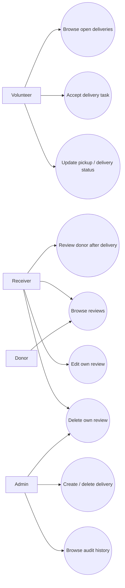

# KhudaMukti — Member 4 Report Material

This section covers the Member 4 deliverables from the team work division. Swagger UI is served at `/api/docs`; all protected routes use bearer-token authentication.

## Use case diagram

## API list

| Method and path                        | Role                   | Purpose                                                 | Example input                                                              | Example successful output                                                                                                                                   |
| -------------------------------------- | ---------------------- | ------------------------------------------------------- | -------------------------------------------------------------------------- | ----------------------------------------------------------------------------------------------------------------------------------------------------------- |
| `GET /deliveries/open?page=1&limit=20` | Volunteer              | Paginated open delivery tasks                           | Query parameters                                                           | `{ "success": true, "data": [{ "id": 12, "claimId": 31, "status": "OPEN" }], "meta": { "page": 1, "limit": 20, "total": 1, "pages": 1, "durationMs": 4 } }` |
| `PATCH /deliveries/:id/accept`         | Volunteer              | Atomically assign an open task to the current volunteer | No body                                                                    | Delivery with `status: "ACCEPTED"`                                                                                                                          |
| `PATCH /deliveries/:id/status`         | Assigned volunteer     | Move task to `PICKED_UP` or `DELIVERED`                 | `{ "status": "PICKED_UP" }`                                                | Delivery with status and corresponding timestamp                                                                                                            |
| `POST /deliveries`                     | Admin                  | Manually create an open task for a claim                | `{ "claimId": 31 }`                                                        | New delivery with `status: "OPEN"`                                                                                                                          |
| `DELETE /deliveries/:id`               | Admin                  | Remove a delivery                                       | No body                                                                    | `{ "message": "Delivery deleted successfully" }`                                                                                                            |
| `POST /reviews`                        | Receiver               | Rate a donor for a completed delivery                   | `{ "claimId": 31, "rating": 5, "comment": "Food was delivered on time." }` | Review with the donor derived from the listing                                                                                                              |
| `GET /reviews?page=1&limit=20`         | Logged-in user         | Paginated review list                                   | Query parameters                                                           | `{ "success": true, "data": [{ "id": 4, "rating": 5 }], "meta": { "page": 1, "limit": 20, "total": 1, "pages": 1, "durationMs": 3 } }`                      |
| `GET /reviews/:id`                     | Logged-in user         | Read one review                                         | No body                                                                    | Review record                                                                                                                                               |
| `PATCH /reviews/:id`                   | Review author          | Edit rating or comment                                  | `{ "rating": 4, "comment": "Updated note" }`                               | Updated review                                                                                                                                              |
| `DELETE /reviews/:id`                  | Review author or Admin | Remove a review                                         | No body                                                                    | `{ "message": "Review deleted successfully" }`                                                                                                              |
| `GET /audit-logs?page=1&limit=20`      | Admin                  | Paginated listing/claim mutation history                | Query parameters                                                           | `{ "success": true, "data": [{ "action": "UPDATE", "entity": "food_listings" }], "meta": { "page": 1, "limit": 20, "total": 1, "pages": 1 } }`              |

All successful JSON responses are wrapped as `{ success, message, data, meta }`; response serialization removes any `password` property at every nesting level. Errors use `{ success, statusCode, message, path, timestamp }` and never include stack traces. Validation rejects unknown fields and malformed DTO values. Conflict responses use HTTP 409.

## Validation and error examples

- Missing/invalid `rating`, invalid delivery status, or unknown body properties return HTTP 400.
- A volunteer updating a delivery assigned to someone else gets HTTP 403.
- Two volunteers accepting the same delivery cannot both succeed: the conditional update allows one, and the other gets HTTP 409.
- A review for an undelivered task or a task owned by another receiver is rejected.
- Requests without a valid bearer token return HTTP 401 through the shared authentication guard.

## Evidence still to capture during the integrated demo

Capture Swagger `/api/docs`, create/read/update/delete for both entities, pagination metadata, 400 validation, 401, 403, 409 concurrent acceptance, and an Admin audit-log view. These require the Member 1 register/login flow to issue tokens, the Member 3 claims workflow, and a configured PostgreSQL database. This branch includes the shared JWT verification/role guards and the Claim entity contract needed by Member 4 routes.
